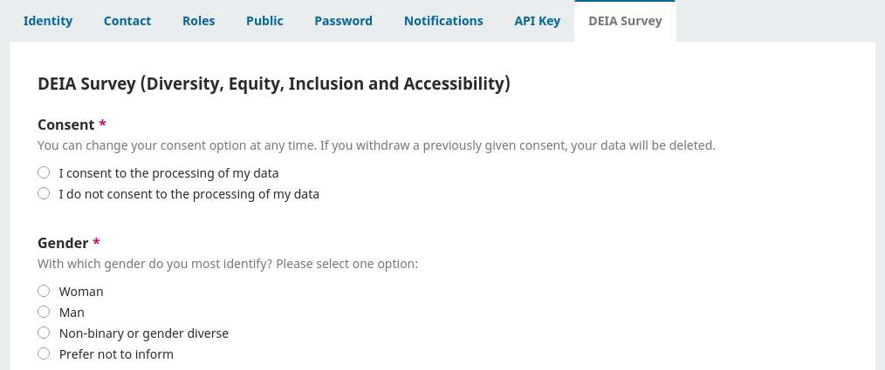
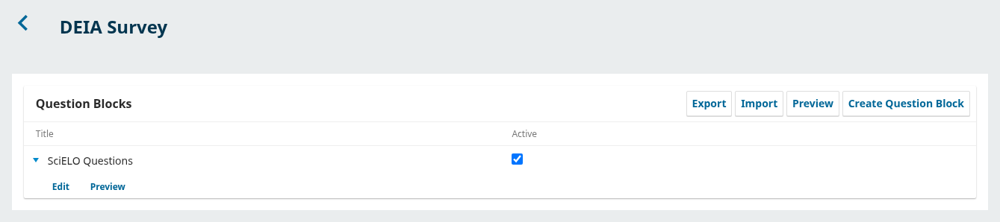
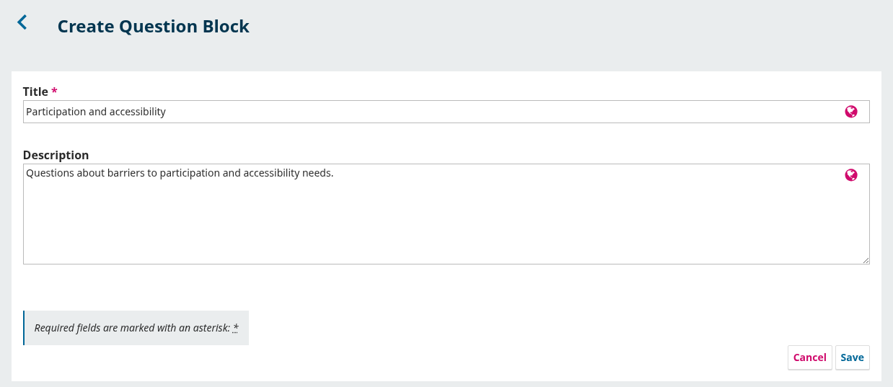
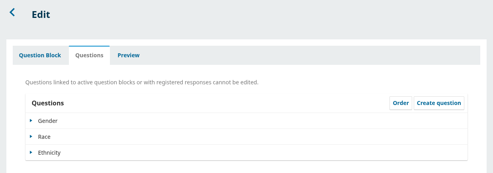
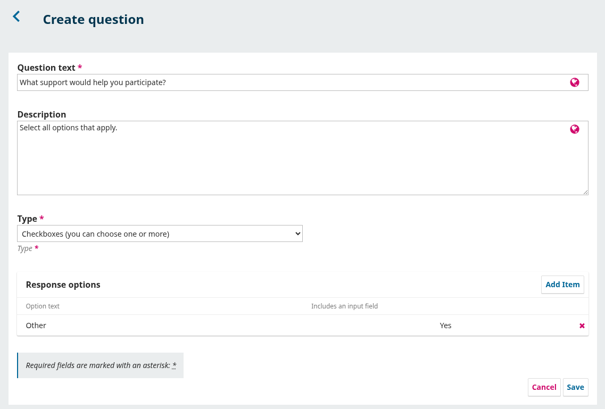

**English** | [Português Brasileiro](/docs/README-pt_BR.md)

# DEIA Survey (Diversity, Equity, Inclusion, and Accessibility)

This plugin allows the collection of DEIA data from users via a questionnaire.

## Compatibility

This plugin is compatible with the following PKP applications:

- OJS and OPS versions 3.3, 3.4 and 3.5.

Check the latest compatible version for your application on the [Releases page](https://github.com/lepidus/deiaSurvey/releases).

## Plugin Download

To download the plugin, go to the [Releases page](https://github.com/lepidus/deiaSurvey/releases) and download the tar.gz package of the latest release compatible with your OJS/OPS.

## Installation

1. Enter the administration area of ​​your application and navigate to `Settings`>` Website`> `Plugins`> `Upload a new plugin`.
2. Under __Upload file__ select the file __deiaSurvey.tar.gz__.
3. Click __Save__ and the plugin will be installed on your OJS/OPS.

## Instructions for use
Once enabled, the questionnaire is displayed in the users profile page. When accessing this page, the user will find a new tab, called "DEIA Survey", where they can consent to answer the questionnaire or not.



For authors who are not registered in the system, an e-mail is sent when the submission is accepted, requesting them to fill in the questionnaire. This e-mail is only sent to authors where there is no user with the same e-mail address in the system.

The e-mail sent offers two ways of filling in the questionnaire. The first requires an ORCID record to be authenticated, so that the data is associated with this record. The second uses the author's e-mail address and is recommended only for those who do not have an ORCID record.

Users can view and delete their data at any time. For the authors without registration who answered the questionnaire, if they create an account in the system with the e-mail address or ORCID used, their data will be migrated to this new user.

## Managing question blocks

Journal and preprint server managers can create and maintain DEIA question blocks. Enable the plugin in the journal or preprint server, go to `Settings` > `Website` > `Plugins`, expand the DEIA Survey plugin row, and select `Manage Question Blocks`.

When the plugin is enabled in a context without questions, it creates an active `SciELO Questions` block. Expand a block row to access its editing and preview actions.



*Question block manager in OJS 3.5.*

Use `Create Question Block` to add a block. Enter a title and, optionally, a description in the available languages, then click `Save`. New blocks start inactive.



*Creating a question block.*

After saving the block, expand its row, select `Edit`, and open the `Questions` tab. Select `Create question` to add a question. Keep the block inactive while creating, editing or ordering its questions. Questions with registered responses cannot be edited even after the block is deactivated.



*Managing questions in an inactive block.*

Each question requires question text and a question type. An optional description can provide instructions to users. Fill in the text in the available languages. Text question types do not use response options. Checkbox, radio button and drop-down questions use response options: select `Add Item` and enter the option text. For checkbox and radio button questions, enable `Includes an input field` when the answer should allow a custom text value, such as “Other”. Drop-down questions do not display this additional text field. Click outside the option row to finish editing it, then click `Save` to save the question.



*Configuring a question and its response options.*

After adding at least one question, use the checkbox in the block list to activate the block and confirm the action. Empty blocks cannot be activated. Only active blocks are displayed to users in the DEIA Survey tab. Use the ordering controls in the block and question managers to define the questionnaire order.

## Question block import and export

The plugin can export and import DEIA question blocks as JSON files from the question block manager in the plugin settings. Imported question blocks are created as inactive, so they can be reviewed before being displayed to users.

The JSON file must use this structure:

```json
{
  "plugin": "deiaSurvey",
  "blocks": [
    {
      "title": {
        "en": "Funding DEIA questions"
      },
      "description": {
        "en": "Questions about access to funding opportunities."
      },
      "questions": [
        {
          "questionType": "TYPE_CHECKBOXES",
          "questionText": {
            "en": "Are you a scholarship recipient?"
          },
          "questionDescription": {
            "en": "Select all funding sources that apply."
          },
          "responseOptions": [
            {
              "optionText": {
                "en": "Institutional scholarship"
              },
              "hasInputField": false
            },
            {
              "optionText": {
                "en": "Other"
              },
              "hasInputField": true
            }
          ]
        },
        {
          "questionType": "TYPE_TEXT_FIELD",
          "questionText": {
            "en": "What support do you need?"
          },
          "questionDescription": {
            "en": "Describe the support that would help your participation."
          },
          "responseOptions": []
        }
      ]
    }
  ]
}
```

Accepted `questionType` values:

- `TYPE_SMALL_TEXT_FIELD`
- `TYPE_TEXT_FIELD`
- `TYPE_TEXTAREA`
- `TYPE_CHECKBOXES`
- `TYPE_RADIO_BUTTONS`
- `TYPE_DROP_DOWN_BOX`

Text fields use localized objects, where each key is a locale code such as `en`, `en_US`, `es`, or `pt_BR`. `responseOptions` is only needed for checkbox, radio button and drop-down questions; use an empty array for text questions.

## Credits
This plugin was sponsored by Lepidus Tecnologia, Scientific Electronic Library Online (SciELO), Revista Encontros Bibli (UFSC) and Associação Brasileira de Saúde Coletiva (ABRASCO).

Developed by Lepidus Tecnologia.

## License

__This plugin is licensed under the GNU General Public License v3.0__

__Copyright (c) 2024-2026 Lepidus Tecnologia__
