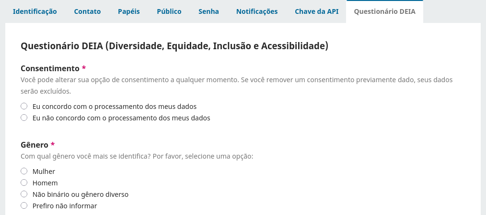
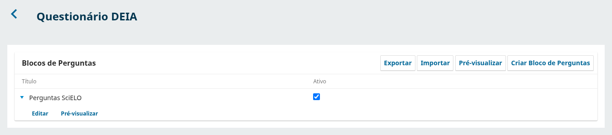
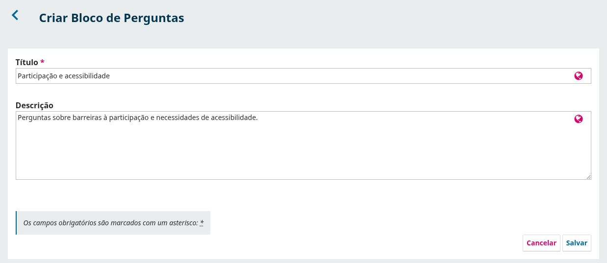
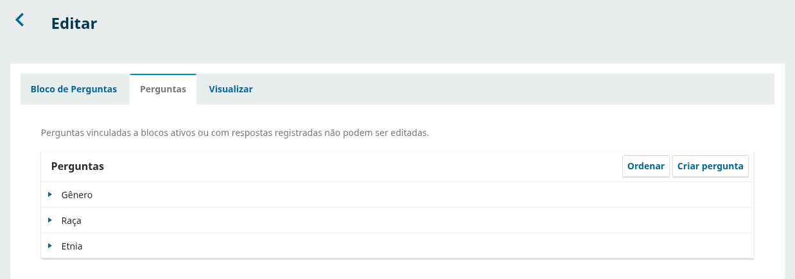
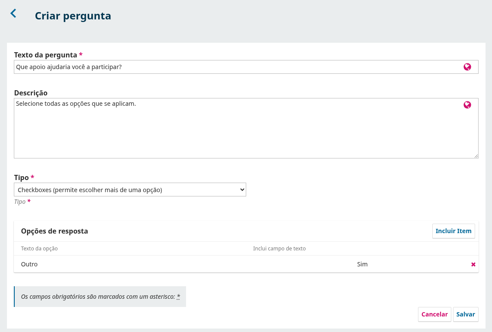

[English](/README.md) | **Português Brasileiro**

# Questionário DEIA (Diversidade, Equidade, Inclusão e Acessibilidade)

Este plugin permite a coleta de dados DEIA dos usuários através de um questionário.

## Compatibilidade

Este plugin é compatível com as seguintes aplicações PKP:

- OJS e OPS nas versões 3.3, 3.4 e 3.5.

Verifique a última versão compatível com a sua aplicação na [Página de Versões](https://github.com/lepidus/deiaSurvey/releases).

## Download do plugin 

Para fazer download do plugin, vá até a [Página de Versões](https://github.com/lepidus/deiaSurvey/releases) e faça download do pacote tar.gz da última versão compatível com o seu OJS/OPS.

## Instalação

1. Entre na área administrativa do seu site OJS através do __Painel de Controle__.
2. Navegue até `Configurações`> `Website`> `Plugins`> `Carregar um novo plugin`.
3. Em __Carregar arquivo__, selecione o arquivo __deiaSurvey.tar.gz__.
4. Clique em __Salvar__ e o plugin será instalado no seu OJS/OPS.

## Instruções de uso
Assim que o plugin for ativado, o questionário será exibido na página de perfil do usuário. Ao acessar essa página, o usuário encontrará uma nova aba, chamada "Questionário DEIA", onde poderá consentir em responder o questionário ou não.



Para autores que não estiverem registrados no sistema, um e-mail será enviado quando a submissão for aceita, requisitando que estes preencham o questionário. Esse e-mail é enviado apenas para autores para os quais não há um usuário no sistema com o mesmo endereço de e-mail.

O e-mail enviado oferece duas maneiras de preencher o questionário. A primeira requere que um registro ORCID seja autenticado, de forma que os dados fiquem associados a esse registro. A segunda utiliza o endereço de e-mail do(a) autor(a) e é recomendada apenas para aqueles que não possuem um registro ORCID.

Os usuários podem ver e excluir seus dados a qualquer momento. Para os autores sem cadastro que preencheram o questionário, caso estes criem um usuário no sistema com o mesmo endereço de e-mail ou ORCID utilizado, seus dados serão migrados para este novo usuário.

## Gerenciamento de blocos de perguntas

Gerentes de revistas e servidores de preprints podem criar e manter blocos de perguntas DEIA. Ative o plugin na revista ou no servidor de preprints, acesse `Configurações` > `Website` > `Plugins`, expanda a linha do plugin Questionário DEIA e selecione `Gerenciar Blocos de Perguntas`.

Ao ser ativado em um contexto sem perguntas, o plugin cria o bloco `Perguntas SciELO` já ativo. Expanda a linha de um bloco para acessar as ações de edição e pré-visualização.



*Gerenciador de blocos de perguntas no OJS 3.5.*

Use `Criar Bloco de Perguntas` para adicionar um bloco. Preencha o título e, opcionalmente, a descrição nos idiomas disponíveis e clique em `Salvar`. Novos blocos começam inativos.



*Criação de um bloco de perguntas.*

Depois de salvar o bloco, expanda sua linha, selecione `Editar` e abra a aba `Perguntas`. Use `Criar pergunta` para adicionar uma pergunta. Mantenha o bloco inativo enquanto cria, edita ou ordena suas perguntas. Perguntas com respostas registradas não podem ser editadas mesmo após a desativação do bloco.



*Gerenciamento das perguntas de um bloco inativo.*

Cada pergunta exige um texto e um tipo. Uma descrição opcional pode orientar os usuários. Preencha os textos nos idiomas disponíveis. Tipos de perguntas textuais não usam opções de resposta. Perguntas de caixas de seleção, botões de opção e lista suspensa usam opções de resposta: selecione `Incluir Item` e preencha o texto da opção. Para perguntas de caixas de seleção e botões de opção, marque `Inclui campo de texto` quando a resposta deve permitir um valor personalizado, como “Outro”. Perguntas de lista suspensa não exibem esse campo adicional. Clique fora da linha da opção para encerrar sua edição e, depois, em `Salvar` para salvar a pergunta.



*Configuração de uma pergunta e de suas opções de resposta.*

Após cadastrar pelo menos uma pergunta, use a caixa de seleção na lista de blocos para ativar o bloco e confirme a ação. Blocos vazios não podem ser ativados. Apenas blocos ativos são exibidos aos usuários na aba Questionário DEIA. Use os controles de ordenação nos gerenciadores de blocos e perguntas para definir a ordem do questionário.

## Importação e exportação de blocos de perguntas

O plugin pode exportar e importar blocos de perguntas DEIA como arquivos JSON pelo gerenciador de blocos de perguntas nas configurações do plugin. Os blocos importados são criados como inativos, para que possam ser revisados antes de serem exibidos aos usuários.

O arquivo JSON deve usar esta estrutura:

```json
{
  "plugin": "deiaSurvey",
  "blocks": [
    {
      "title": {
        "pt_BR": "Perguntas DEIA sobre financiamento"
      },
      "description": {
        "pt_BR": "Perguntas sobre acesso a oportunidades de financiamento."
      },
      "questions": [
        {
          "questionType": "TYPE_CHECKBOXES",
          "questionText": {
            "pt_BR": "Você recebe alguma bolsa?"
          },
          "questionDescription": {
            "pt_BR": "Selecione todas as fontes de financiamento aplicáveis."
          },
          "responseOptions": [
            {
              "optionText": {
                "pt_BR": "Bolsa institucional"
              },
              "hasInputField": false
            },
            {
              "optionText": {
                "pt_BR": "Outro"
              },
              "hasInputField": true
            }
          ]
        },
        {
          "questionType": "TYPE_TEXT_FIELD",
          "questionText": {
            "pt_BR": "De qual apoio você precisa?"
          },
          "questionDescription": {
            "pt_BR": "Descreva o apoio que ajudaria sua participação."
          },
          "responseOptions": []
        }
      ]
    }
  ]
}
```

Valores aceitos para `questionType`:

- `TYPE_SMALL_TEXT_FIELD`
- `TYPE_TEXT_FIELD`
- `TYPE_TEXTAREA`
- `TYPE_CHECKBOXES`
- `TYPE_RADIO_BUTTONS`
- `TYPE_DROP_DOWN_BOX`

Os campos textuais usam objetos localizados, em que cada chave é um código de idioma, como `en`, `en_US`, `es` ou `pt_BR`. `responseOptions` só é necessário para perguntas de caixas de seleção, botões de opção e lista suspensa; use um array vazio para perguntas textuais.

## Créditos
Este plugin foi patrocinado por Lepidus Tecnologia, Scientific Electronic Library Online (SciELO), Revista Encontros Bibli (UFSC) e Associação Brasileira de Saúde Coletiva (ABRASCO).

Desenvolvido por Lepidus Tecnologia.

## License

__Este plugin é licenciado sob a GNU General Public License v3.0__

__Copyright (c) 2024-2026 Lepidus Tecnologia__
